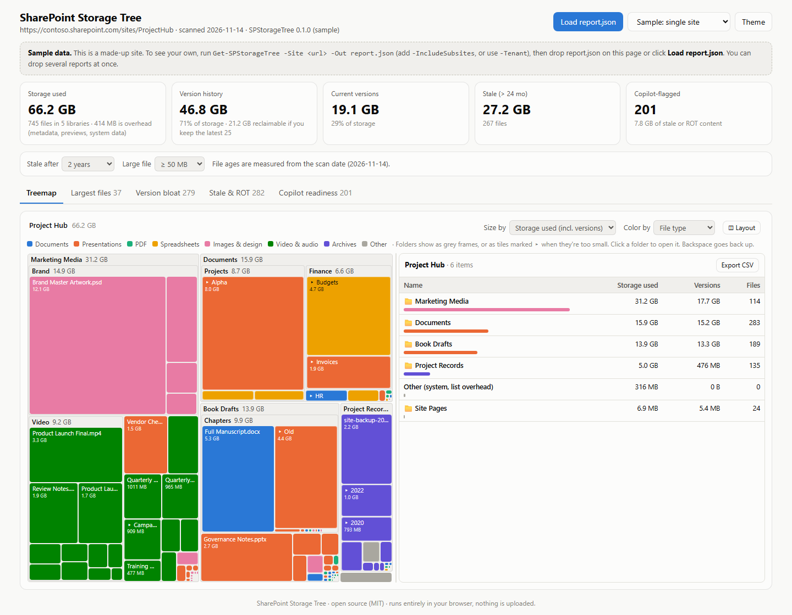
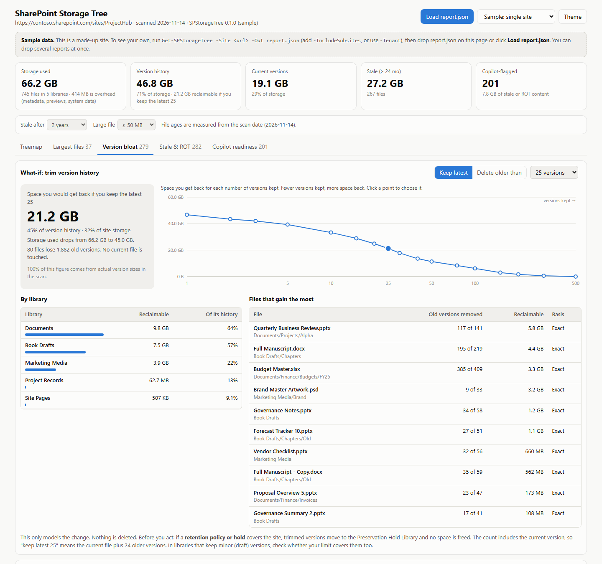
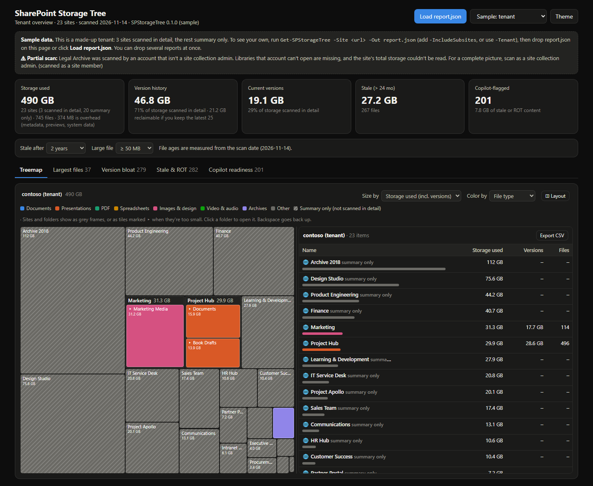
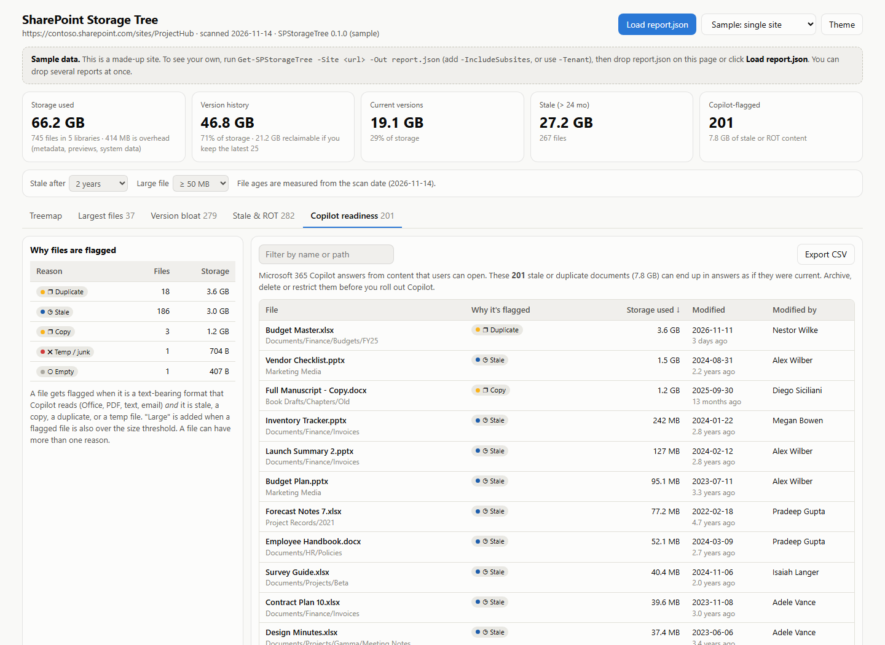

# SharePoint Storage Tree

**TreeSize for SharePoint.** An open-source PowerShell module that scans SharePoint Online and shows where the storage goes, as a treemap you can click into. It also shows how much space version history takes, what you'd get back by trimming it, and which stale or redundant files Microsoft 365 Copilot can surface in answers.

- **Read-only.** It never changes anything in SharePoint.
- **Local.** The scan writes a JSON report on your machine. The viewer is one HTML file with no dependencies that runs offline in your browser. Nothing is uploaded anywhere.
- **One site, a site with its subsites, or the whole tenant.**



*All screenshots use the viewer's built-in sample data (a made-up "contoso" tenant).*

## What you get

| View | Answers |
|---|---|
| **Treemap** + contents table | Which sites, libraries, folders and files use the space. Size by storage used, current version, version history or reclaimable space. Color by file type, age or version bloat. |
| **Version bloat** + **what-if** | How much is old versions, and how much you'd get back if you kept only the latest *N* versions, or deleted versions older than *N* days. Exact where the scan fetched per-version sizes, estimated elsewhere (and labeled as such). |
| **Largest files** | The biggest current files. |
| **Stale & ROT** | Files not modified in *N* months, plus redundant, obsolete or trivial content: copies, duplicates, temp files, empty files. |
| **Copilot readiness** | Stale or ROT documents in formats Copilot can read, which can show up in answers as if they were current. |

Every table exports to CSV.

**What-if: keep the latest 25 versions.** The curve shows how much each limit gets back; the tables show which libraries and files gain most.



**Tenant mode** (dark theme). Sites scanned in detail open into libraries and folders; the rest show as striped summary tiles with their storage total.



**Copilot readiness.** Stale, duplicate and copied documents in formats Copilot reads, with the reason for each.



## Requirements

- PowerShell 7.4 or later
- [PnP.PowerShell](https://pnp.github.io/powershell/) 3.x
- An Entra ID app registration for PnP PowerShell in your tenant (one-time; see below)

```powershell
Install-PSResource SPStorageTree     # also installs PnP.PowerShell
```

## One-time setup: an app registration

Since September 2024, PnP PowerShell can't sign in without your tenant's own app registration (Microsoft retired the shared one). If your tenant already has one for PnP PowerShell, use its Client ID. If not, someone who can grant admin consent runs:

```powershell
# site and subsite scans only: read-only is enough
Register-PnPEntraIDAppForInteractiveLogin -ApplicationName "SharePoint Storage Tree" -Tenant contoso.onmicrosoft.com -SharePointDelegatePermissions AllSites.Read

# also tenant mode
Register-PnPEntraIDAppForInteractiveLogin -ApplicationName "SharePoint Storage Tree (admin)" -Tenant contoso.onmicrosoft.com -SharePointDelegatePermissions AllSites.FullControl
```

and shares the Client ID it prints. Everyone then signs in with their own account through that app.

### Permissions (delegated, SharePoint)

| Scan | Minimum app permission | Tested |
|---|---|---|
| `-Site`, `-Site -IncludeSubsites` | **AllSites.Read** | Same result as AllSites.FullControl, file for file. |
| `-Tenant` (the site list) | **AllSites.FullControl** | AllSites.Read and AllSites.Manage are refused by the admin API. |

These are delegated permissions: the app can never do more than the signed-in person can. The tool only reads, whichever permission the app has. If your organization doesn't want a FullControl app, use a read-only app and run `-Site` scans per site instead of `-Tenant`.

## Scan

```powershell
# one site
Get-SPStorageTree -Site https://contoso.sharepoint.com/sites/ProjectHub -ClientId <client-id> -Open

# a site and all its subsites
Get-SPStorageTree -Site https://contoso.sharepoint.com/sites/ProjectHub -ClientId <client-id> -IncludeSubsites -Open

# whole tenant: every site's total, plus the 5 largest sites in detail
Get-SPStorageTree -Tenant contoso -ClientId <client-id> -Top 5 -Open

# whole tenant, plus chosen sites in detail
Get-SPStorageTree -Tenant contoso -ClientId <client-id> -DeepScan https://contoso.sharepoint.com/sites/Finance, https://contoso.sharepoint.com/sites/HR
```

`-Open` writes `report.html` next to `report.json` (the viewer with your data built in) and opens it. Without it, open a report any time with:

```powershell
Show-SPStorageTree .\report.json
Show-SPStorageTree .\finance.json, .\hr.json      # several reports, one view
```

Or open `storagetree.html` from the module's `viewer` folder and drag one or more `report.json` files onto it. The viewer also has built-in sample data for each scan mode.

| Parameter | Default | |
|---|---|---|
| `-Out` | `report.json` | Where to write the report. |
| `-VersionDetailMinVersions` | `10` | Fetch exact per-version sizes for files with at least this many old versions... |
| `-VersionDetailMinHistoryMB` | `50` | ...or at least this much version history. |
| `-VersionBatchSize` | `50` | Files per version-detail request. |
| `-ExcludeUserNames` | off | Leave people's names out of the report (to share it more widely). |
| `-Pretty` | off | Indented JSON. |

## Who can scan what

Sign-in is delegated: the tool can read exactly what your account can read. Tested against a lab tenant:

| Your role | Site mode | Tenant mode |
|---|---|---|
| **Site collection admin** of the site | Full scan. | n/a |
| **Site member/owner** (not site collection admin) | **Partial** scan: files and versions are read, but the site's total storage can't be, and libraries with their own permissions are left out. The report is marked partial and the viewer says so. | n/a |
| **SharePoint Administrator / Global Administrator** | Full scan **only where you're also site collection admin**. An admin role doesn't grant access to site content. | Site list with every site's total. Sites you can't read in detail stay in the report as summary only, with a warning. |

The tenant site list (`Get-PnPTenantSite`) doesn't include OneDrive accounts.

## Sign-in tips

- **The browser picks the account.** Interactive sign-in reuses whatever account your default browser is signed in to. To scan as someone else, sign out there first, or connect yourself with `Connect-PnPOnline -Url <site> -OSLogin -ClientId <id>` (the Windows account picker), then run `Get-SPStorageTree -Site <site>` without `-ClientId`.
- **Device-code sign-in** (`-DeviceLogin`) is blocked in tenants that use Security Defaults (error AADSTS530035).

## How the numbers work

- **Storage used** per file is SharePoint's `SMTotalSize`: the current file, its old versions, and per-file overhead (metadata and, for images and video, previews). The tool splits that into **version history** (what trimming can free) and **other overhead** (what it can't). A file that has never been edited (version 1.0) has nothing to reclaim.
- **Every document library is scanned, including hidden and system ones** (Site Pages, Site Assets, the app catalog, galleries). That's what makes the total match the admin center. System libraries count toward storage but are never flagged as stale, ROT or Copilot risk.
- Whatever the files don't account for (list items, system data) shows as **Other (system, list overhead)**, so the treemap total equals the site's storage figure.
- **Version counts** come from the version label (e.g. 16.0 = 16 versions) unless per-version detail was fetched. Libraries with minor (draft) versions have more versions than the label suggests; detailed files show the exact count.
- **Before you trim:** if a retention policy or hold covers the site, deleted versions move to the Preservation Hold Library and no space is freed. The report records whether the site has one.

## Speed

Each detailed site takes roughly one request per library (one per 5,000 files) plus one request per 50 files that get version detail. A lab site with 376 files across 14 libraries took 11 requests and about 5 seconds. Tenant mode adds a single request for the site list.

## Subsites

New subsites are disabled by default in current tenants. If you need to create one (for testing), the setting is only on the classic settings page: `https://<tenant>-admin.sharepoint.com/_layouts/15/online/TenantSettings.aspx` > **Subsite Creation**. Scanning existing subsites doesn't need it.

## Privacy

Reports and the generated `.html` contain file names, folder paths, sizes and people's names from your tenant. Handle them like any other internal data. The viewer makes no network requests.

## Known limits

- Files whose total size (file plus versions) is over 2 GB may come back with a wrong total from SharePoint; the scanner detects this, counts the current size only, and warns.
- Brand-new or just-changed files may not have storage metrics yet; they're counted at their current size, with a warning.

## Development

```powershell
./build.ps1                    # copies the viewer into the module, checks the manifest, runs PSScriptAnalyzer
Invoke-Pester ./tests          # offline tests, no SharePoint needed
```

CI runs both on Windows and Linux for every push.

## License

MIT. Copyright (c) 2026 G Vijai Kumar.
